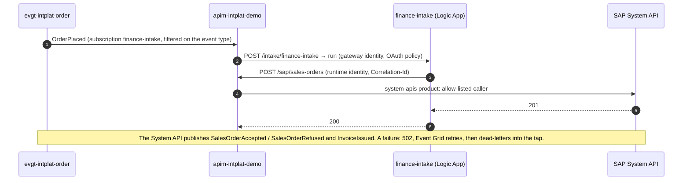
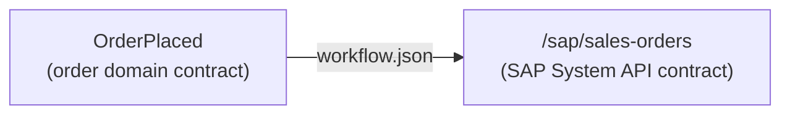
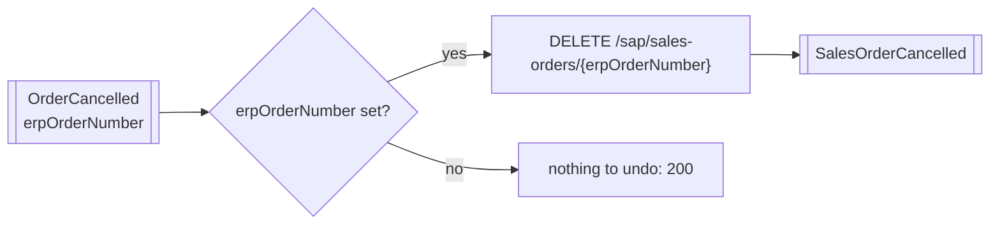

# finance-intake

The **finance domain's intake flow** ([ADR 0015](https://github.com/azure-intelligence-domain/ai-intelligence-domain/blob/main/docs/adr/0015-one-intake-per-domain.md)):
what the finance domain takes in from other domains. A Logic App (Consumption), owned by the
**finance-team**. It receives **OrderPlaced** and creates the sales order in SAP, through the gateway, with the
SAP System API; the System API then publishes SalesOrderAccepted / SalesOrderRefused and InvoiceIssued.
It also receives **OrderCancelled** (below).

| File | What |
|---|---|
| [`workflow.json`](workflow.json) | The flow: switch on the event type, map, call the System API |
| [`asyncapi.yaml`](asyncapi.yaml) | Consumer contract: what it receives (from the Order Process API's released contract) |
| [`infra/main.bicep`](infra/main.bicep) | The Logic App, its runtime identity, and its OAuth policy (the gateway only) |
| [`tests/`](tests/) | The flow against its contract |

## Mapping

The flow maps the order domain's event onto the SAP System API's contract; nothing else.

## When an order is cancelled (since 1.1.0)

**OrderCancelled** names what each domain has for the order ([ADR 0018](https://github.com/azure-intelligence-domain/ai-intelligence-domain/blob/main/docs/adr/0018-cancellation-reaches-every-domain.md)).
If it carries `erpOrderNumber`, the flow cancels the SAP sales order; a credit note reverses the invoice: `DELETE /sap/sales-orders/{erpOrderNumber}?reason=`, and the SAP System API
publishes **SalesOrderCancelled**. Without `erpOrderNumber` the SAP has nothing for this order yet, and the run ends
`200` without a call.

## When a delivery fails

The flow does not retry: if the System API refuses or fails, the run ends in `502 Delivery
Failed`, Event Grid retries the delivery (3 attempts), then dead-letters the event into the tap
storage (`sttapintplatdemo`, container `deadletters`, folder `finance-intake`). The Intelligence domain
sees it there; nobody has to search Logic App run histories.

## Cost

Pay per run, nothing polls: an idle flow costs nothing. A run is about five built-in actions plus
one HTTP call.

## Pipeline

`.github/workflows/deploy.yml`: contract check and flow tests, then on `main` (OIDC as
`id-intplat-finance-intake`): the Logic App, a smoke test (a call without the gateway's token gets `401`),
and a deployment event.
